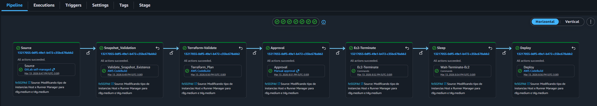

# GitLab CE Self-Hosted on AWS with Terraform

This repository contains Terraform modules and templates to provision a self-hosted GitLab CE environment on AWS. It serves as a reference architecture covering everything from base networking to automated runner scaling.

### Project Stack

- **Core Infra:** Local modules for VPC, subnets, NAT instance, security groups, EC2, EBS, KMS, RDS, S3, IAM, Load Balancer, WAF, ACM, Route 53, SNS and CloudWatch.
- **Provisioning:** `user_data` and runner templates located in `templates_tpl/`.
- **CI/CD:** `buildspec` files for AWS CodePipeline/CodeBuild (plan and apply) in `codepipeline/`.
- **Secrets & Parameters:** AWS Secrets Manager and SSM Parameter Store.

## Overview architecture


### What gets created

- **Network:** a VPC with 3 public and 3 private subnets across 3 availability zones, an Internet Gateway, and an EC2 NAT instance (not a NAT Gateway) for the private subnets.
- **Entry:** an Application Load Balancer with an HTTP → HTTPS redirect and an ACM certificate (DNS validation), protected by AWS WAF (AWS managed rule groups + geo restriction).
- **GitLab host:** an EC2 instance (Graviton `r8g.medium` by default) in a private subnet, bootstrapped by `templates_tpl/user_data.tpl` and reachable through an EC2 Instance Connect Endpoint.
- **Data outside the host:**
  - PostgreSQL on RDS, with generated credentials stored in Secrets Manager.
  - Repositories on a dedicated KMS-encrypted EBS volume mounted at `/var/opt/gitlab`.
  - One S3 bucket per object type: artifact, lfs, uploads, packages, backups, cache and files.
- **CI runners:**
  - A Runner Manager (`t4g.medium`, docker-autoscaler).
  - 12 Auto Scaling Groups: arm64 (`t4g`) and amd64 (`t3a`), small / medium / large, each one shared and dedicated.
  - Shared groups use Spot. Dedicated groups use On-Demand, with a warm pool on small and medium.
  - Every group starts at `desired_capacity = 0`. The macOS group is commented out in `main.tf`.
- **Resilience & observability:**
  - Daily EBS snapshots with DLM (03:00, kept 7 days).
  - Daily `gitlab-backup` to S3 (06:00; 30-day lifecycle on the backups bucket).
  - RDS backups kept 7 days.
  - CloudWatch agent and alarms for CPU, memory and disk, sent to SNS.
  - Automatic reboot when the EC2 status check fails.
- **DNS:** a private hosted zone for the GitLab domain pointing to the load balancer. The public zone and SES are managed outside this project.
- **Integrations (optional):** SMTP through SES, SAML SSO and Bitbucket import, configured in `gitlab.rb` by `user_data.tpl`.

## CodePipeline Suggested Pipeline



The pipeline itself is created outside Terraform; this repository ships the two CodeBuild buildspecs it uses.

| Stage                 | Provider            | What it does                                                                                |
| --------------------- | ------------------- | ------------------------------------------------------------------------------------------- |
| Source                | GitLab self-managed | Pulls this repository                                                                       |
| Snapshot_Validation   | AWS CodeBuild       | Validates that an EBS snapshot exists before changing anything                              |
| Terraform-Validate    | AWS CodeBuild       | `codepipeline/buildspec.yml`: `terraform init`, `validate` and `plan`                       |
| Approval              | Manual approval     | A person reviews the plan                                                                   |
| Ec2-Terminate / Sleep | Commands            | Terminates the GitLab host and waits for it (`Wait-Terminate-Ec2`)                          |
| Deploy                | AWS CodeBuild       | `codepipeline/buildspec-apply.yml`: `terraform init`, `validate` and `apply --auto-approve` |

Both buildspecs need `jq`. They rebuild the local secret files (see [Sensitive Data Handling](#sensitive-data-handling)) from the Secrets Manager secret `git_local_files_secrets` before running Terraform.

---

### Recommended Deployment Workflow

To avoid circular dependencies with GitLab tokens, do **not** run a global `terraform apply` on the first pass. Follow this staged approach:

1.  **Backend:** Configure an S3 bucket for the state, with locking (see [Remote Backend](#remote-backend)).
2.  **Provider:** `providers.tf` uses the AWS CLI profile `devops` and project default tags. Change them to match your environment.
3.  **Variables:** Update `terraform.tfvars` with your account, region, domain, CIDRs, instance types and SSM parameter names.
4.  **Secret files:** Create the local JSON files listed in [Sensitive Data Handling](#sensitive-data-handling). Until Phase 2, the runner token files can hold placeholder values.
5.  **Phase 1 (Base):** Provision the core infrastructure (VPC, Security Groups, RDS, LoadBalancer, Route53 and the GitLab Host instance), for example with `terraform apply -target=module.<name>`.
    - The base modules publish their IDs (VPC, subnets, security group, RDS host and port) to SSM Parameter Store.
    - The rest of the stack reads those IDs back through `data.tf`, so they must exist first.
6.  **GitLab Setup:** Once the instance boots, complete the initial setup in the GitLab UI and generate your **Runner Registration Tokens**.
7.  **Phase 2 (Runners):** Write the tokens to the runner token files and run a full `terraform plan` / `terraform apply`.
    - This creates the Runner Manager and the runner Auto Scaling Groups.
    - Terraform also stores the tokens in Secrets Manager (`git_local_files_secrets`).

> **Note:** The GitLab instance must be online to generate the tokens required for runner registration. Attempting to deploy everything at once will result in registration failures.

---

### State & Secrets Management

#### Remote Backend

The `providers.tf` file includes a commented S3 backend example. For shared environments, **always** use encryption and locking:

```hcl
terraform {
  backend "s3" {
    bucket       = "your-terraform-state-bucket"
    key          = "gitlab-self-hosted/terraform.tfstate"
    region       = "us-east-1"
    encrypt      = true
    use_lockfile = true # Terraform >= 1.10; on older versions use dynamodb_table = "terraform-lock"
  }
}
```

### How to run the project

1.  **Initialize Terraform:**
    ```bash
    terraform init
    ```
2.  **Plan the deployment:**
    ```bash
    terraform plan
    ```
3.  **Apply the changes:**
    ```bash
    terraform apply
    ```

### Sensitive Data Handling

Never commit secrets to version control. This project is structured to pull sensitive values (DB passwords, tokens, SES keys) via AWS Secrets Manager or local files ignored by Git.

`locals.tf` reads these files from the repository root (all ignored by the `*.json` rule in `.gitignore`):

- `root.json`: GitLab root password
- `ses.json`: SES SMTP access and secret keys
- `runner_manager_token.json` and `runners_token_*.json`: one token per runner group
- `bitbucket.json`: Bitbucket OAuth app key and secret
- `sso_credentials.json`: SAML IdP certificate and URL

Terraform stores their values in the Secrets Manager secret `git_local_files_secrets`, and the buildspecs recreate the files from it in CodeBuild. `terraform.tfvars` **is** committed, so keep secrets out of it.

### Operation & Security Notes

User Data: The script in templates_tpl/user_data.tpl handles the GitLab bootstrap. Before scaling, validate the Instance IAM Role (least privilege) and ensure the script matches your AMI architecture (x86 vs. Arm64; the default host type is Graviton).

Hardening: Prefer the EC2 Instance Connect Endpoint over opening SSH in Security Groups, enable detailed CloudWatch logging, and review S3/RDS backup lifecycle policies.

Runners: Runners use auto-scaling. Review the `autoscaling_configs_for_runners_*` blocks in `terraform.tfvars` (instance types, Spot vs. On-Demand, `max_size`, warm pool) to optimize for your specific workload costs.

### Repository layout

- `main.tf`, `variables.tf`, `terraform.tfvars`, `locals.tf`, `data.tf`, `outputs.tf`, `providers.tf`: root configuration.
- `modules/`: 30 local modules. `cloudfront`, `elastic_ip`, `iam` and `iam_role` are not used by `main.tf`.
- `templates_tpl/`: `user_data.tpl` (GitLab host and `gitlab.rb`), `runner_manager.tpl`, `runners_amd64.tpl`, `runners_arm64.tpl` and `runners_arm64_mac.tpl`.
- `codepipeline/`: `buildspec.yml` (plan) and `buildspec-apply.yml` (apply).

### Diagrams

- `./media/gitlab-self-hosted.drawio`: editable source (draw.io).
  - Page 1: the architecture as implemented.
  - Page 2: a Disaster Recovery target design, not implemented.
- `./media/gitlab-self-hosted-Gitlab - Self Hosted.jpg`: export of page 1.
- `./media/gitlab-self-hosted-Gitlab - Self Hosted.drawio.png`: editable PNG export of page 1 (opens in draw.io).
- `./media/codepipeline.png`: suggested AWS CodePipeline structure for CI/CD automation.

### License

This project is licensed under the [MIT License](./LICENSE).
